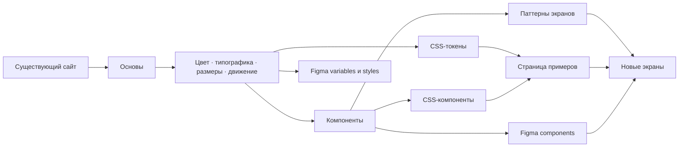

# Карта дизайн-системы

Документация описывает систему для новых экранов портфолио. Кодовые токены и компоненты лежат в [`assets/design-system.css`](../../assets/design-system.css), визуальные примеры — на странице [`/design-system/`](../../design-system/index.html), библиотека — в [Figma](https://www.figma.com/design/JDdwr6tCTr1LlcFIypbrcj).

## Структура

## Разделы

- [patterns.md](patterns.md) — библиотека паттернов и CSS-классов.
- [tokens.md](tokens.md) — значения и назначение токенов.
- [playbook.md](playbook.md) — порядок сборки нового экрана и правила реализации.
- [figma.md](figma.md) — Figma-библиотека, структура файла и соответствия с кодом.

## Быстрые ссылки

- [Посмотреть страницу-пример](../../design-system/index.html)
- [Открыть Figma Design System](https://www.figma.com/design/JDdwr6tCTr1LlcFIypbrcj)
- [Открыть карту связей в FigJam](https://www.figma.com/board/aD8A7V1A8gdlErnokiHgBC)

Сайт остаётся статическим HTML/CSS. Главная страница и существующие кейсы не подключают эту систему автоматически; применяйте её при создании новых экранов.
